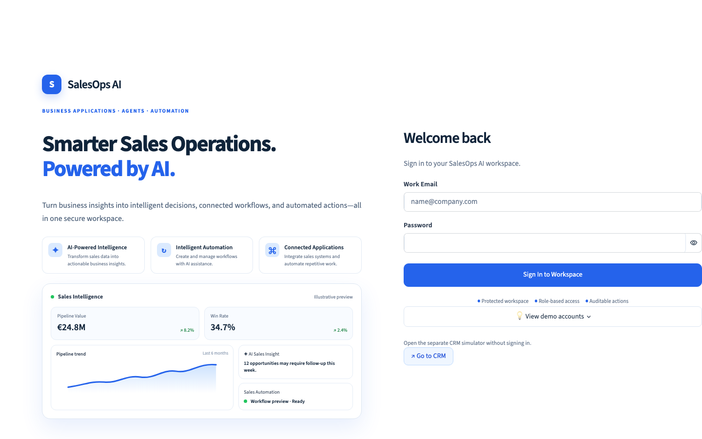
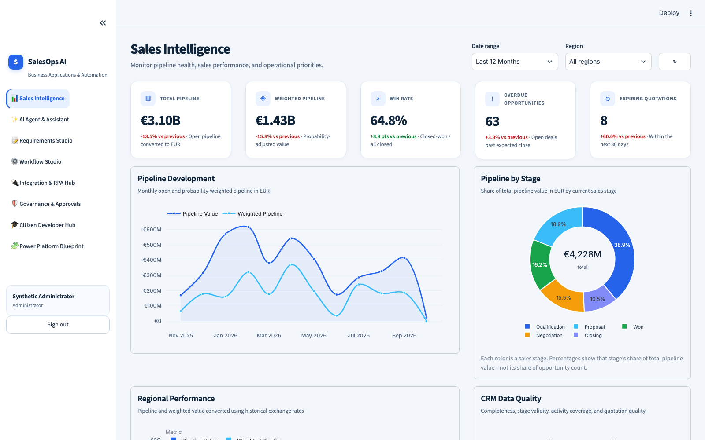
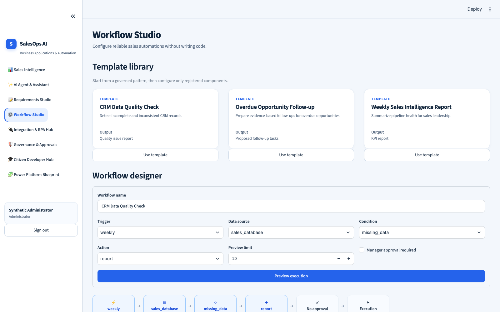
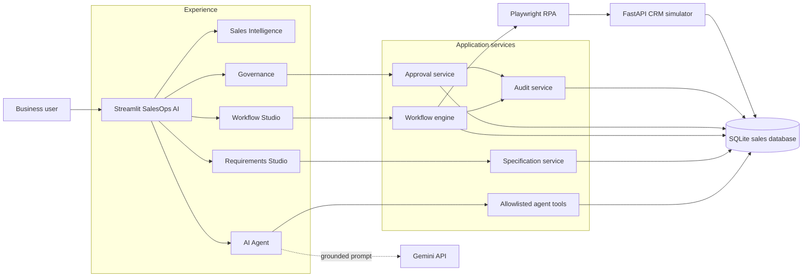
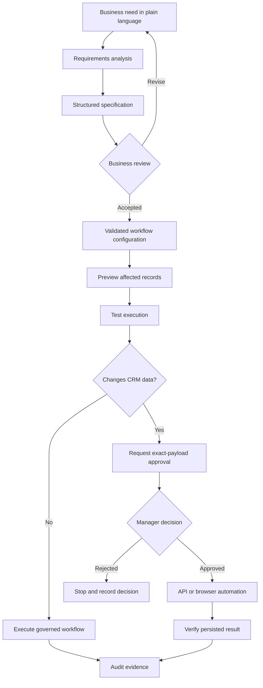
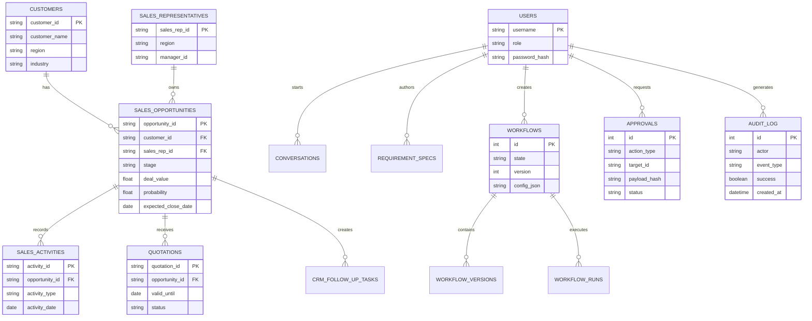

# SalesOps AI

**Business Applications, Agents & Automation Hub for governed sales operations**

SalesOps AI is a portfolio-grade business application showing how sales data, AI assistance, workflow automation, approvals, integrations, and citizen-development governance can work together. It converts fragmented records into operational insight, turns plain-language requirements into structured workflows, and keeps system-changing actions reviewable and approval-bound.

### Live application

**[Open SalesOps AI on Streamlit Community Cloud](https://salesflowai.streamlit.app/)**

The separate, no-login CRM workspace is available through the **Go to CRM** button on the application login page.



> This repository uses synthetic data and local demonstration accounts. It is designed for solution prototyping and architecture demonstration, not as an internet-ready production system.

## Purpose

SalesOps AI is designed to help a sales organization understand its pipeline, find work that needs attention, design repeatable processes, and automate approved actions safely.

In many organizations, sales information is spread across CRM systems, quotation tools, spreadsheets, emails, activity logs, and reporting platforms. A manager may be able to open each system, but still cannot quickly see the complete situation. Important quotations may expire, opportunities may become overdue, CRM fields may remain incomplete, and repetitive follow-up work may depend on manual reminders.

This application brings those activities into one demonstration workspace. It does not replace every enterprise system. Instead, it shows how those systems can be connected through a governed business application that combines analytics, AI assistance, workflow automation, approvals, RPA, and audit records.

The system is intended to answer practical questions such as:

- Which opportunities need attention now?
- Why did the win rate change?
- Which quotations will expire soon?
- Where is CRM information incomplete?
- Which repetitive actions can be automated safely?
- How can citizen developers build solutions without bypassing governance?

SalesOps AI demonstrates a governed response to those problems. It provides verified analytics, grounded AI interpretation, reusable automation templates, exact-payload approvals, audit evidence, and a path toward an enterprise Power Platform architecture.

## What the system does

At a simple level, the application follows this process:

1. **Collect and organize sales data.** It stores synthetic customers, opportunities, quotations, activities, representatives, workflow records, approvals, and audit events in a relational database.
2. **Calculate reliable business metrics.** The application calculates pipeline value, weighted pipeline, win rate, overdue opportunities, expiring quotations, stage distribution, and regional performance directly from the data.
3. **Highlight sales risks.** Dashboards and attention lists show stalled opportunities, expiring quotations, missing CRM information, and other records that may require action.
4. **Explain the information with AI.** A user can ask a sales question in ordinary language. The system first runs a controlled data tool and then gives the verified result to Gemini for interpretation.
5. **Convert ideas into specifications.** A business user can describe a requirement such as “create a follow-up process for overdue opportunities.” Requirements Studio turns that idea into structured triggers, conditions, actions, data needs, risks, and acceptance criteria.
6. **Build and test workflows.** Workflow Studio provides reusable templates and validated configuration. Users can preview affected records and run a test before activating an automation.
7. **Request approval for data-changing actions.** If a workflow will modify a CRM record, it must request approval. The approval is tied to the exact action, target record, and payload, so it cannot be reused for a different change.
8. **Perform and verify the approved action.** The integration layer or browser robot performs the approved CRM operation and checks that the result was saved.
9. **Record evidence.** Important events are written to the audit log, including workflow runs, approval decisions, AI conversations, CRM actions, and failures.

## Example user journey

Imagine that a sales manager wants to reduce the number of overdue opportunities:

1. The manager opens **Sales Intelligence** and sees the number and value of overdue opportunities.
2. They ask the **AI Agent** which records need attention and why.
3. The agent calls an allowlisted database tool and displays the verified opportunity evidence separately from its explanation.
4. The manager describes a desired follow-up process in **Requirements Studio**.
5. A citizen developer uses the resulting specification to configure an overdue follow-up workflow in **Workflow Studio**.
6. The workflow is previewed and tested without changing CRM data.
7. A manager reviews and approves the exact follow-up action.
8. The CRM integration creates the approved task and verifies that it was persisted.
9. **Governance & Approvals** shows who requested, approved, and executed the action.

## Why it is useful

- **Sales managers** receive one view of pipeline health, conversion, overdue opportunities, quotation risk, regional performance, and data quality. This helps them prioritize coaching and follow-up instead of manually combining reports.
- **Sales representatives** can identify opportunities and quotations that need immediate attention and see approved follow-up tasks in the CRM workspace.
- **Sales operations teams** can convert recurring business problems into clear technical specifications and repeatable automation instead of relying on undocumented manual processes.
- **Citizen developers** receive templates, test mode, approval rules, lifecycle states, and implementation guidance that help them build without bypassing organizational controls.
- **Application owners and governance teams** can review roles, approvals, workflow versions, executions, and audit evidence.
- **Solution architects** can evaluate integration patterns, relational data modelling, AI boundaries, RPA trade-offs, security controls, and a Power Platform migration path.
- **Business stakeholders** can see a working prototype before committing to a larger production implementation.

## Core capabilities

| Capability | What the user can do | Why it matters |
|---|---|---|
| Sales Intelligence | Review KPIs, pipeline trends, stage distribution, regional performance, data-quality issues and prioritized attention lists. | Gives managers a clear operational picture and helps them focus on the highest-risk records. |
| AI Agent & Assistant | Ask sales questions in natural language and receive an explanation based on controlled, verified database tools. | Makes analysis easier while keeping factual evidence separate from AI-generated interpretation. |
| Requirements Studio | Describe a business need and generate a structured specification containing goals, triggers, conditions, actions, data requirements and acceptance criteria. | Reduces misunderstanding between business stakeholders and technical delivery teams. |
| Workflow Studio | Start from a template, configure workflow logic, validate it, preview affected records, run tests, create versions and control lifecycle state. | Allows automation ideas to be tested safely before activation. |
| Integration & RPA Hub | Review connector status, prepare CRM actions and use browser automation when a legacy application has no suitable API. | Demonstrates how modern applications can work with both APIs and older user interfaces. |
| Governance & Approvals | Review pending requests, approve or reject exact actions, inspect roles and examine audit evidence. | Prevents an AI agent or automation from making unrestricted changes to business systems. |
| Citizen Developer Hub | Use reusable patterns, guidance, guardrails and delivery checklists. | Helps business-led development remain supportable, secure and consistent. |
| Power Platform Blueprint | Explore how the prototype maps to Power Apps, Power Automate, Dataverse, Copilot Studio, DLP, CoE and ALM. | Provides a practical transition path from Python prototype to governed enterprise low-code architecture. |
| CRM Workspace | Search opportunity records, review important values and create only approval-matched follow-up tasks without signing into the main workspace. | Shows the final operational destination of a governed workflow and works in the hosted Streamlit deployment. |

## Product tour

### Sales Intelligence dashboard

The dashboard gives managers an immediate view of total and weighted pipeline, win rate, overdue opportunities, and expiring quotations. Filters support focused analysis by period and region, while the charts explain pipeline development and how total value is distributed across sales stages.



### Workflow Studio

Workflow Studio helps a citizen developer start from a governed template instead of building an automation from nothing. The user can select a trigger, data source, condition and action, require manager approval, limit the preview, and inspect the execution path before running the workflow.



## System architecture



### Design principles

1. **Verified facts and AI interpretation are separate.** Deterministic tools calculate evidence; the model explains it.
2. **The agent has no arbitrary SQL, Python, shell, or browser access.** It can request only registered tools with validated arguments.
3. **CRM-changing actions require approval.** Approval is bound to the action type, target record, and canonical payload hash.
4. **Automation is tested before activation.** Preview and test mode expose affected records and expected output.
5. **Important actions are auditable.** Workflow runs, approvals, AI conversations, CRM actions, and failures leave evidence.

## Business workflow



## Database model

The local UI uses a relational SQLite database. The generator can also produce larger CSV and Parquet datasets for analytics and data-engineering exercises.



## AI safety model

```text
User question
    -> intent and tool selection
    -> Pydantic argument validation
    -> allowlisted deterministic query/tool
    -> verified result
    -> Gemini interpretation
    -> evidence and interpretation displayed separately
```

If `GEMINI_API_KEY` is not configured, the verified-data path remains usable and the application returns a deterministic fallback rather than inventing a result.

## Authentication and authorization

| Demo username | Role | Typical permissions |
|---|---|---|
| `admin` | Administrator | Full governance, workflow, approval, RPA and audit access |
| `manager` | Sales Manager | Analysis, workflow activation, approvals, RPA and audit access |
| `builder` | Citizen Developer | Analysis, workflow creation and approval requests |

The local demo password is `salesops-demo`. Passwords are stored as Argon2id hashes, failed attempts are throttled, and UI sessions expire after 30 minutes. Replace these accounts with enterprise identity before production use.

## Power Platform blueprint

The protected **Power Platform Blueprint** page maps the demonstrated patterns to:

- Power Apps for role-aware business applications
- Dataverse for governed business data
- Power Automate for solution-aware workflows and approvals
- Copilot Studio and Azure AI for grounded agents
- Custom connectors and desktop flows for integration
- Managed environments, DLP policies, Entra ID and field-level security
- CoE inventory, ownership, adoption and lifecycle controls
- Managed solutions and environment promotion pipelines

This is an architecture blueprint. The repository does not claim its Python components are already deployed on Microsoft Power Platform.

## Synthetic data system

- UI database: laptop-friendly SQLite MVP profile
- Full generated profile: 252,490 records across 18 datasets
- Export formats: CSV and Parquet
- Ground-truth issue records: 5,000
- Deterministic generation through a configured seed

No real customer, employee, or commercial data is included.

## Project structure

```text
SalesFlow AI/
├── app.py                         # Authenticated Streamlit shell
├── pages/                         # Business application pages
├── core/                          # Auth, AI, workflow, approval and audit services
├── ui/                            # Shared design system and UI components
├── database/
│   ├── synthetic_data/            # Deterministic data generator
│   ├── generated/                 # CSV and Parquet outputs
│   └── salesops.db                # Local application database
├── legacy_crm/app.py              # Separate FastAPI CRM simulator
├── rpa/crm_robot.py               # Approval-bound Playwright automation
├── tests/salesops/                # Service and Streamlit tests
├── docs/                          # Security, implementation and user guidance
└── .streamlit/config.toml         # Light theme configuration
```

## Local setup

### Requirements

- Python 3.11 or newer; Python 3.12 is recommended
- Chromium installed through Playwright for browser RPA
- A Gemini API key only when live AI interpretation is required

### Install

```bash
python3.12 -m venv .venv
source .venv/bin/activate
pip install -e '.[dev]'
playwright install chromium
python -m database.import_data --profile mvp --seed 42 --overwrite
```

Create `.env` from `.env.example` and keep secrets local:

```env
GEMINI_API_KEY=your-key
GEMINI_MODEL=your-supported-model
CRM_WEB_URL=http://127.0.0.1:8001
SALESOPS_DEMO_PASSWORD=salesops-demo
```

Never commit `.env`.

## Run the application

Start the separate CRM simulator:

```bash
source .venv/bin/activate
uvicorn legacy_crm.app:app --host 127.0.0.1 --port 8001
```

Start SalesOps AI in another terminal:

```bash
source .venv/bin/activate
streamlit run app.py --server.port 8510
```

Open:

- SalesOps AI: `http://127.0.0.1:8510`
- CRM simulator: `http://127.0.0.1:8001`

The **Go to CRM** button on the login page opens the separate CRM directly.

## Testing

```bash
pytest -q
```

The suite covers relational data, KPIs, tool allowlisting, safe Gemini errors, requirements conversion, workflow permissions, exact-payload approvals, CRM persistence, secret redaction, authentication, and UI registration.

## Deployment considerations

The Streamlit application can be deployed independently, but the current CRM URL points to `127.0.0.1:8001`. That works only during local development. For a shared deployment:

1. Deploy the FastAPI CRM as a separate HTTPS service.
2. Set `CRM_WEB_URL` to its public address.
3. Replace local SQLite with a managed shared database such as PostgreSQL.
4. Replace demo authentication with enterprise identity such as Microsoft Entra ID.
5. Store secrets in the platform's secret manager.
6. Add CSRF controls, TLS, centralized logging, backups, monitoring and immutable audit retention.
7. Review data classification, privacy, retention, access recertification and application ownership.

## Current limitations

- SQLite is intended for a single-host demonstration.
- Streamlit session state is not an enterprise session service.
- The CRM and RPA run as separate local processes.
- The Power Platform implementation is an architecture mapping, not a live tenant deployment.
- Synthetic data cannot reproduce every production edge case.
- Live AI behavior depends on API availability, model access and quotas.

## Documentation

- [Security model](docs/security.md)
- [Implementation progress](docs/implementation_progress.md)
- [Citizen developer guide](docs/citizen_developer_guide.md)
- [Synthetic-data documentation](database/README.md)

## Usage

Try the hosted application at **[salesflowai.streamlit.app](https://salesflowai.streamlit.app/)**. This repository is intended for learning, prototyping, solution architecture demonstrations, and portfolio review. Review security, licensing, privacy, and operational requirements before adapting it for organizational use.
