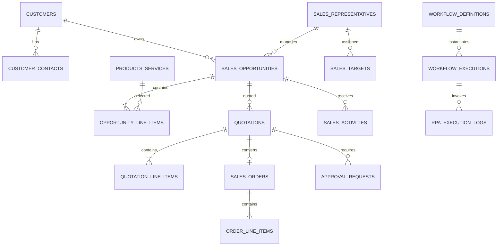

# SalesFlow AI data dictionary

All identifiers are stable strings. Money uses `Decimal` commercial rounding and exports as two-decimal numeric values. CSV timestamps are ISO-8601; Parquet uses native timestamps.

| Dataset | Primary key | Important foreign keys and purpose |
|---|---|---|
| customers | customer_id | Canonical customer account, geography, segment, currency |
| customer_contacts | contact_id | customer_id; synthetic stakeholder contact |
| sales_representatives | sales_rep_id | Territory owner and region |
| products_services | product_id | Sellable catalog and EUR reference price |
| sales_opportunities | opportunity_id | customer_id, sales_rep_id; pipeline lifecycle and value |
| opportunity_line_items | opportunity_line_item_id | opportunity_id, product_id; proposed scope |
| quotations | quotation_id | opportunity_id; commercial offer and validity |
| quotation_line_items | quotation_line_item_id | quotation_id, product_id; quoted terms |
| sales_orders | order_id | accepted quotation_id, opportunity_id |
| order_line_items | order_line_item_id | order_id, product_id; accepted commercial terms |
| sales_activities | activity_id | opportunity_id, sales_rep_id; calls, meetings and follow-ups |
| approval_requests | approval_request_id | quotation_id, opportunity_id; high-discount decisions |
| sales_targets | target_id | sales_rep_id; monthly target period |
| exchange_rates | exchange_rate_id | Historical EUR quote rates |
| crm_data_quality_issues | issue_id | Synthetic issue metadata, distinct from secret ground truth |
| workflow_definitions | workflow_definition_id | Versioned workflow metadata |
| workflow_executions | workflow_execution_id | workflow_definition_id; synthetic historical run |
| rpa_execution_logs | rpa_execution_log_id | workflow_execution_id; synthetic robot outcome |

Recommended indexes cover every foreign key plus opportunity `(sales_rep_id, stage)`, activity `(sales_rep_id, due_date, status)`, quotation `(status, expiration_date)`, order `(order_date, currency)`, and exchange rate `(quote_currency, rate_date)`.

